

  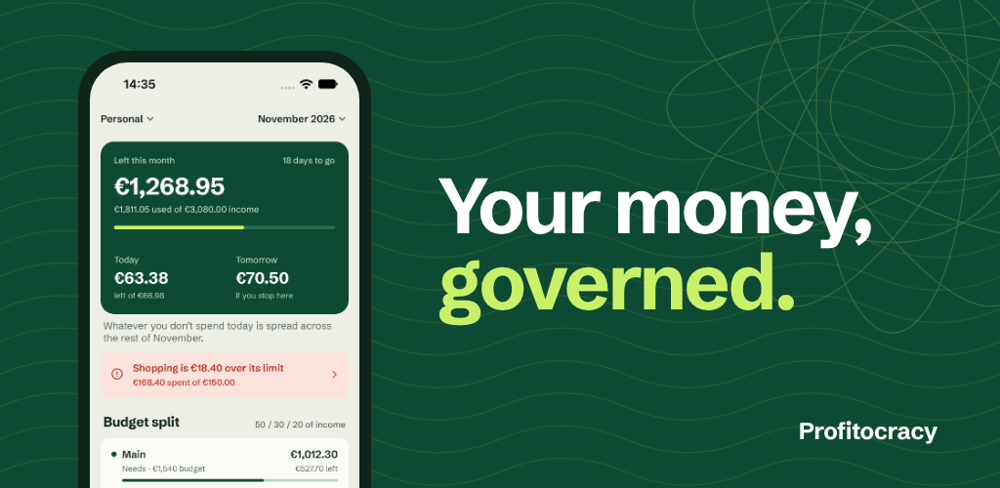

    
    

Welcome to the source code of **Profitocracy**.

**Profitocracy** is a powerful budget management app designed to help users track their expenses effortlessly while following the 50-30-20 budgeting rule.

# Key Features of Profitocracy

- 💰 **Track Your Expenses**. Stay on top of your finances by organizing your spending effortlessly using the [50-30-20 rule](#503020rule).
- 📊 **Customize Spending Categories**. Create, set budgets, and easily monitor your spending in personalized categories.
- 📅 **Monthly Budget Planning**. Automatically generate a tailored budget to make every month stress-free.
- 🔒 **Complete Data Privacy**. Rest assured that your data is secure, Profitocracy does not share your information with third parties. Everything is stored locally on your device.
- 🌍 **Multi-Currency Support**. Track expenses in different currencies with seamless conversion for global users.
- 📈 **Visualize Your Spending with Charts**. Gain clear insights into your expenses with beautifully crafted charts and graphs.
- 👥 **Multiple Profiles**. Manage separate budgets or accounts for different individuals or purposes all within one app.
- 💻 **Open-Source**. Profitocracy is open-source, ensuring transparency and the support of a thriving community for constant improvements.

## Android Preview

    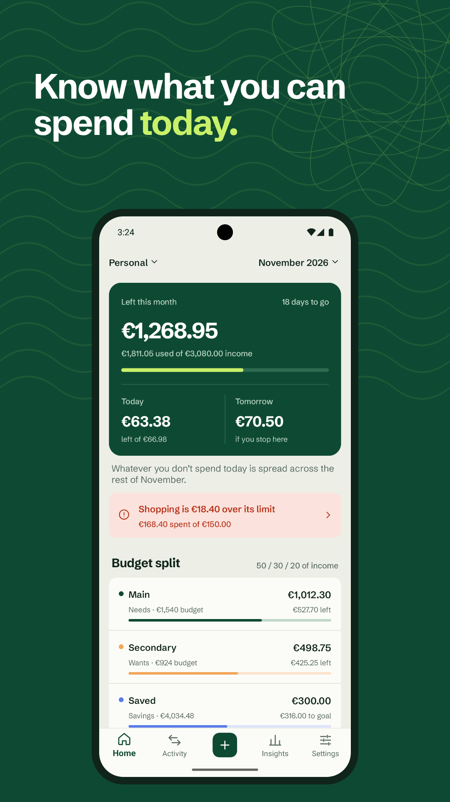
    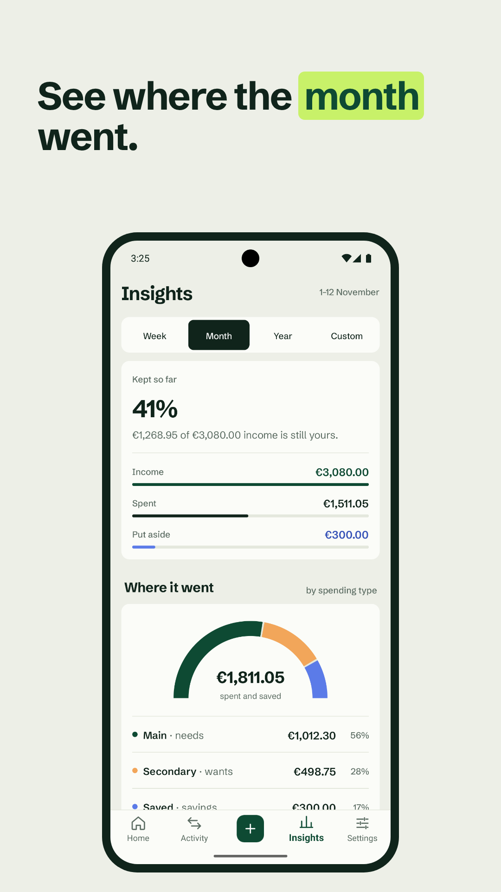
    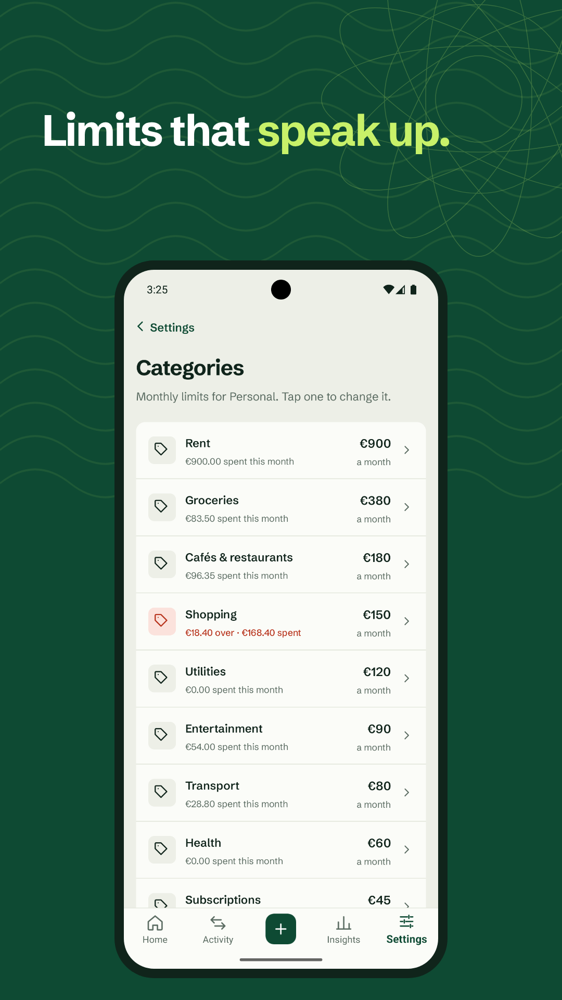
    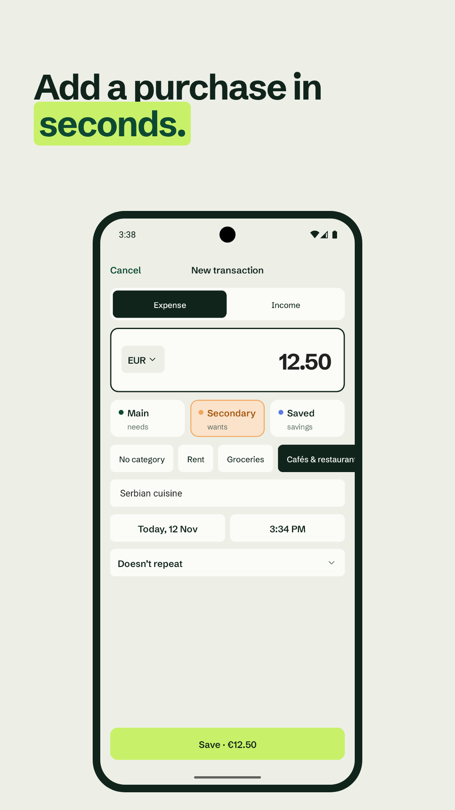
    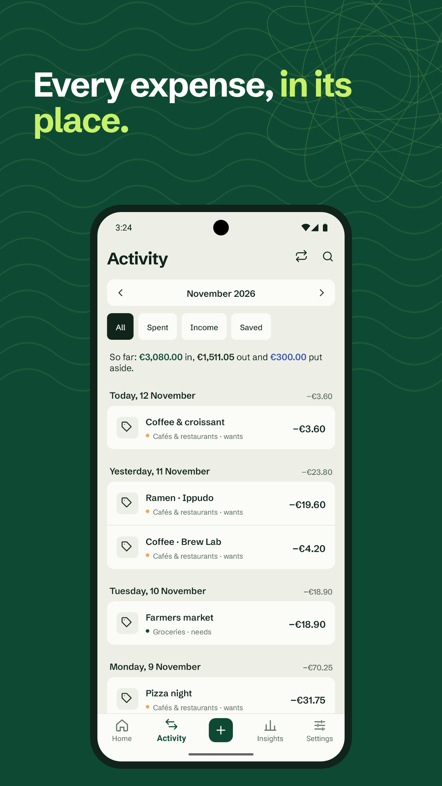
    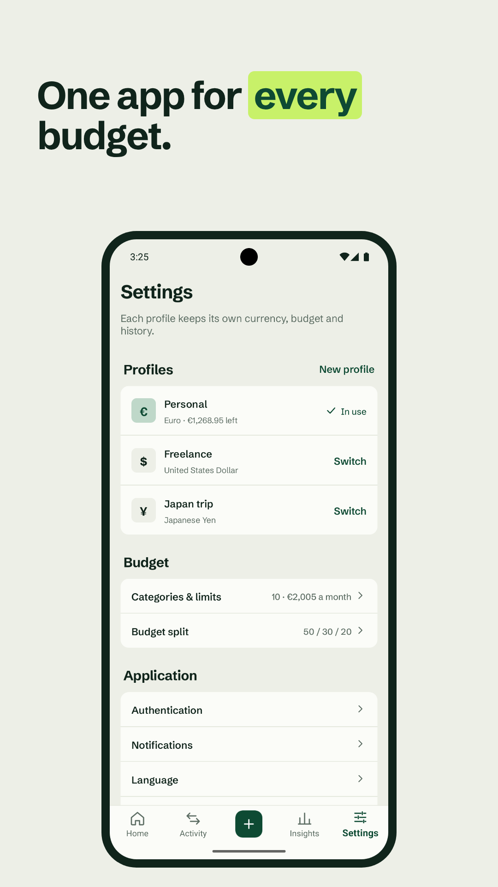

## iOS Preview

    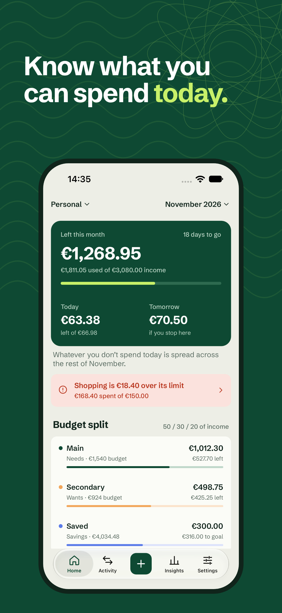
    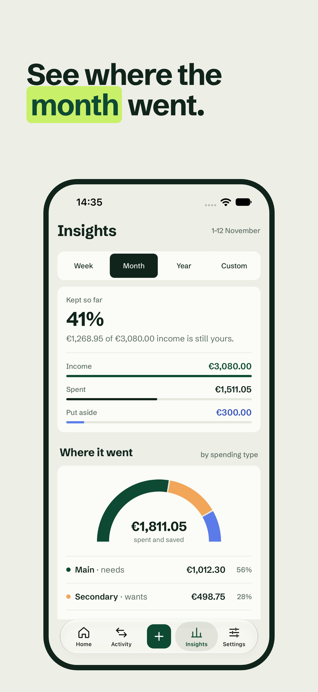
    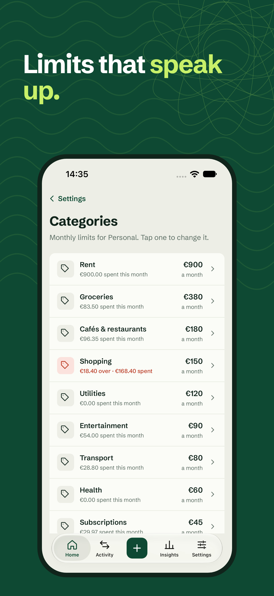
    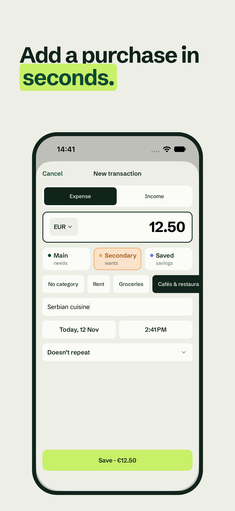
    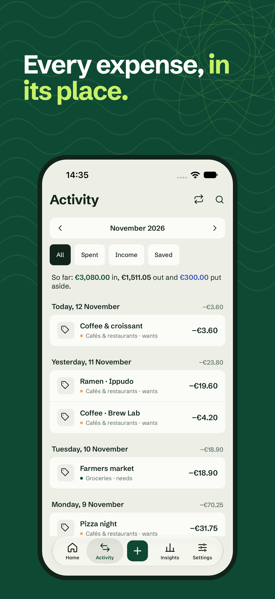
    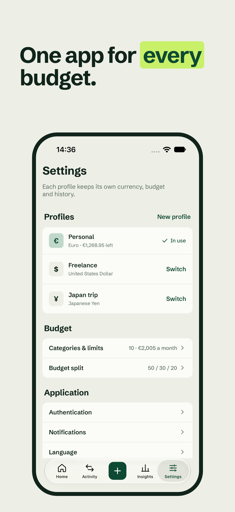

# Installation

## Android

To install Profitocracy to an Android device through the Google Play, click on the following link:

    

To install Profitocracy to an Android device manually via an APK file, go to the [latest release](https://github.com/KrawMire/profitocracy-maui/releases/latest) and install an attached *.apk* file.
Then click on it and follow the instructions.

> If you want to try out a specific version of Profitocracy, go to
> [the list of releases](https://github.com/KrawMire/profitocracy-maui/releases)
> and select the version you would like to install.

## iOS

You can download the Profitocracy on the Apple App Store by following [this link](https://apps.apple.com/rs/app/profitocracy/id6503658740) or by clicking on the following image:

    

# More About Profitocracy

##  What is a 50-30-20 rule

The 50-30-20 rule is a common way to allocate the spending categories in your personal or household budget.
The rule targets 50% of your after-tax income toward necessities, 30% toward things you don’t need—but make
life a little nicer and the final 20% toward paying down debt and/or adding to your savings.

## Terminologies Used in Profitocracy

### 💼 Profile

A **Profile** represents all your financial activity in one place. It tracks your expenses and calculates amounts for primary, secondary, and savings expenses. Additionally, it provides insights into your daily spending as well as categorized expenses for better organization.

### 🧾 Transaction

A **Transaction** is an operation that moves funds. It can either be an **income** (e.g., your salary) or an **expense** (e.g., groceries, rent). For expense transactions, you’ll need to specify:
- The **type** of expense: primary, secondary, or savings.
- The **amount** spent.

You can also optionally provide additional details such as:
- **Spending category** (default is "None").
- **Description** of the transaction.
- **Date** of the operation.

### 💵 Actual and Planned Amounts of Expenses

In Profitocracy, most of the data displayed on the **Home Screen** revolves around expenses. An **expense** is represented by two key values:
- **Actual Amount:** The real amount of money spent for a specific type or category.
- **Planned Amount:** The amount Profitocracy suggests as your spending limit for each category or type.

This balance between actual and planned amounts helps you stay in control of your financial goals.

### 📊 Category

A **Category** is a grouping tool for your transactions. Each category can be customized with:
- A **name** (e.g., Food, Entertainment).
- An optional **planned amount** for the month (set during creation on the **Settings Screen**).

Once created, you can track your category-wise spending on the **Home Screen.**

- If a planned amount is set, Profitocracy compares your spending against it for better tracking.
- If no planned amount is defined, the app simply displays the total expenses for the category during the ongoing month.
